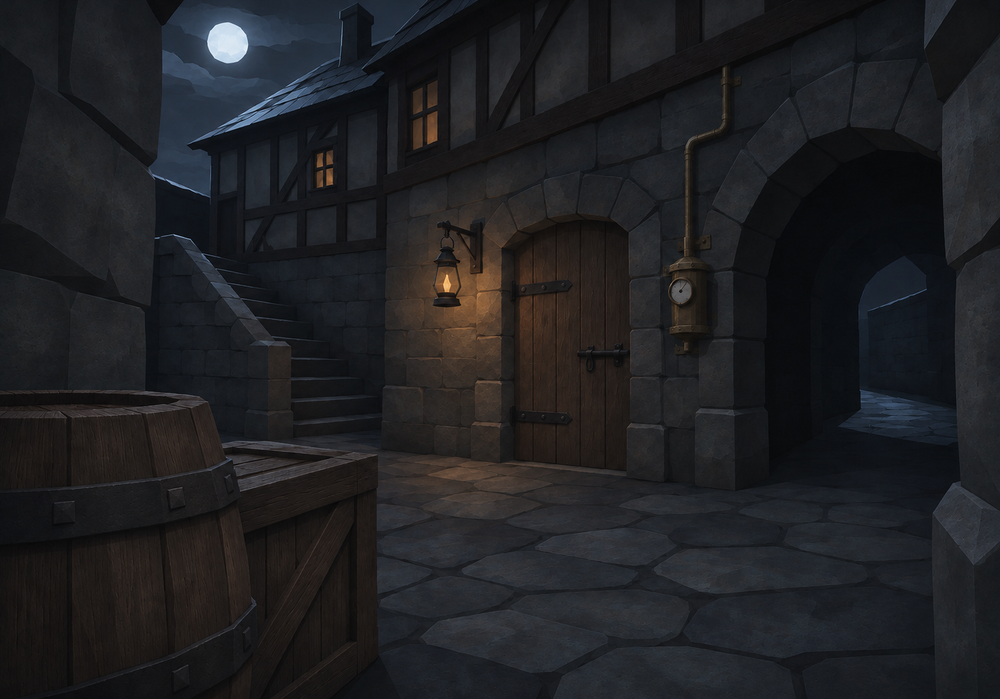

# План развития AssetGen

Аудит от 19 ноября 2026 года. План предлагает порядок работ и критерии приёмки. Контрольные сборки выполнены на Blender 5.2.3 LTS.

Разделы «Как работает AssetGen» и «Что показала проверка» описывают состояние на дату аудита. Ниже сохранены [результаты первой итерации](#результат-первой-итерации) и последующих прогонов. Действующие возможности сверяй с [README](../README.md) и схемами. Новые задачи по пунктам плана веди по [правилам репозитория](../AGENTS.md).

## Визуальный ориентир

Изображение предоставлено автором проекта. Используем его как ориентир для материалов и читаемости low-poly форм в игровом свете.

- **Дерево.** Тёмные матовые доски с направленным тонким волокном. Стыки и перепады тона между клёпками читаются с игровой дистанции. Мелкое зерно, торец и потёртости заметны вблизи. На крышке, боковине бочки и раскосе ящика рисунок следует направлению каждой детали.
- **Железо и латунь.** Обручи и дверные петли из тёмного приглушённого железа. Заклёпки и кромки ловят свет, широкие поверхности сохраняют слабый блеск. Труба и корпус прибора дают отдельный тёплый акцент.
- **Камень.** Крупные холодные серые блоки, широкие неровные фаски, сдержанная зернистость и небольшая разбежка оттенков. Стыки кладки и края ступеней читаются за счёт формы и теней.
- **Приёмка.** Оценивать материал в Godot в холодном общем свете и у локального тёплого источника. С игровой дистанции должны читаться форма, стыки и тип материала, вблизи — зерно и износ. Сохранять цвет ночного света и фонаря в освещении сцены, чтобы один albedo работал в обоих условиях.

Для следующего прохода по `barrel_01` ориентиры из кадра — тёмные железные обручи, тонкие древесные волокна и утопленная крышка с читаемым торцом клёпок. Глубину крышки проверять сбоку и под ¾.

## Как работает AssetGen

| Этап | Точка входа | Что происходит |
|---|---|---|
| Спецификация | `assetgen.py new`, `validate`, `validate-texture` | Модель и текстура описываются в двух JSON. CLI проверяет их по схемам и запускает Blender отдельным процессом. Флора использует тот же конвейер, её скрипт генерирует пары JSON. |
| Модель | `assetgen.py model <name>` → `blender/build_model.py` | Пять примитивов (`box`, `cylinder`, `sphere`, `lathe`, `extrude`), локальные операции, массивы и отражение. Части объединяются в один объект Blender через join. Затем выставляются pivot и flat shading, строится Smart UV с фиксированными параметрами, при необходимости создаётся коллайдер. |
| Текстура | `assetgen.py texture <name>` → `blender/bake_texture.py` | Открывает базовый `.blend`, подбирает рецепт по тегу материала, создаёт шейдер и запекает один общий sRGB albedo в Cycles на CPU. После bake можно квантовать цвета. В GLB экспортируются albedo, фильтр и скалярные metallic/roughness. |
| Результат | `out/<group>/<name>/` | Базовый и текстурированный `.blend`, GLB, при наличии коллизии отдельный `_godot.glb`, PNG, два отчёта и четыре ракурса. `model` и `texture` используют одни имена для GLB и превью. Копирование в игру опционально. |

См. [CLI](../assetgen.py), [сборщик](../blender/build_model.py), [baker](../blender/bake_texture.py), [схемы](../schemas) и [команды проекта](../README.md).

## Что показала проверка

### Текстуры

- Свежий `barrel_01` на 128 px показывает крупные ступеньки и ломаные полосы. Его спека включает nearest и квантование общей палитрой, а также сильное затемнение AO. При повторном bake с `pixel: false` и `quantize: false` на той же модели ступеньки сгладились, но сохранились размытые полосы и не появился рисунок клёпок. Вклад двух переключателей по отдельности и происхождение видимых разрывов между гранями ещё предстоит измерить.
- `pillar` на 256 px в мягком режиме выглядит как серая гранёная колонна с крупными пятнами. У неё нет отдельных мотивов породы вроде прожилок, сколов или локальных включений. Увеличение размера карты само по себе таких деталей не добавит.
- `wood` умеет сочетать Wave и Noise, `stone` сочетает Noise и Voronoi, `flat` даёт константу. `metal`, `bone` и `cloth` попадают в одну ветку Noise. Кастомные слои дают до четырёх источников (`noise`, `wave`, `voronoi`, `constant`), сводят их к одному средневзвешенному фактору и прогоняют его через общую рампу. Этого хватает для вариаций тона, но выразить ржавчину только в пятнах или отдельную основу и уток ткани таким способом трудно.
- Процедуры используют координаты общего объекта после pivot. Направление и масштаб узора на конкретной детали задать отдельно нельзя. Smart UV для всего меша и `EXTEND` на четыре пикселя по умолчанию настраиваются независимо от фактической плотности островов. Разрывы на островах, недостаточную плотность и вытекание соседнего оттенка на mip-уровнях нужно измерить отдельно. Workbench-превью помогает сравнивать ассеты, а поведение mipmap и освещения следует проверять на импортированном GLB. См. [руководство Blender по bake и полям UV](https://docs.blender.org/manual/en/5.2/render/cycles/baking.html#margin).

### Углубления

В DSL есть реальные углубления, которые можно описать поперечным профилем. У `plate_deep_01` внутренние стенки и дно построены через `lathe` и видны на свежем превью. Для локальной полости в существующем теле операции вычитания нет. Join объединяет данные частей, сохраняя их пересекающиеся поверхности.

| Контрольный ассет | Что видно в сборке |
|---|---|
| `skull_01` | Тёмные пятиугольники выступают перед черепом. Лучи по центрам обоих глаз сначала попадают в `dark`, вид сбоку показывает толщину вставок. |
| `skull_02` | Чаши и ободки сделаны отдельно от массы черепа. Лучи по центрам обоих глаз сначала попадают в `bone`, основа перекрывает середину чаш. |
| `skull_67` | Лучи попадают на тёмную поверхность примерно на 16 мм позади контрольной точки на бровной дуге. Отступ создан выступающими деталями и тёмной вставкой, поэтому этот пример показывает, что глубину можно имитировать компоновкой. |

См. [спеки черепов и тарелки](../specs/models).

Для повторения выборочной проверки координаты указаны в метрах в системе меша после pivot. Лучи шли от `Y = −1` вдоль `+Y`. Центры глаз проверены на `(X, Z)` = `(±0.033, 0.120)` у `skull_01`, `(±0.037, 0.099)` у `skull_02`, `(±0.035, 0.098)` у `skull_67`. Контрольная точка на бровной дуге у последнего образца — `(0.035, 0.123)`.

### Код и проверки

- `build_model.py` читает аргументы, сбрасывает сцену и запускает сборку при импорте. Построение примитивов, UV, экспорт и отчёт связаны общими `spec`, `rng` и контекстом Blender. Это усложняет запуск отдельных этапов и тестирование геометрии.
- `bake_texture.py` одновременно разрешает настройки, строит граф узлов, меняет сцену, запекает, экспортирует и пишет отчёт. Defaults для текстур описаны и в JSON Schema, и в Python. Имя неизвестной палитры допускается схемой и обнаруживается только при обращении к словарю baker. Fallback по тегу материала записывается в отчёт, но отдельно не предупреждает о возможной ошибке в имени.
- `texture` проверяет наличие базового `.blend`, но не его соответствие текущей спеки модели. Повторный `model` перезаписывает GLB и превью, при этом старый отчёт текстуры остаётся на диске. Это создаёт неоднозначность для повторного запуска, проверок и опционального копирования в Godot.
- Тесты схемы, графа, цвета и GLB уже есть. `verify_outputs.py` пропускает несобранные спеки, поэтому зелёный результат зависит от содержимого `out/`. Проверка детерминизма повторяет bake из одного `.blend`. У текущих проверок нет условий для геометрической глубины полости, качества UV или читаемости материала в игре.

## Порядок работ

### 0. Зафиксировать исходное качество

1. Сделать обязательный прогон с чистой временной папкой для `barrel_01`, `pillar`, `skull_01` и `plate_deep_01`. Он должен собрать выбранный набор через CLI и падать при пропущенном этапе или отсутствии ожидаемого артефакта. Существующий режим просмотра локального `out/` полезен для остального каталога.
2. Сохранить сопоставимые превью спереди, сбоку и под ¾, albedo в исходном размере, UV-чекер и снимок из Godot с одной камерой и освещением. Для текстур сравнить два масштаба просмотра, включая игровую дистанцию примерно 1–2 м. Для черепа добавить нейтральный материал без текстуры и срез через глазничную ось.
3. Записывать версию Blender, seed, размер карты, число островов, долю занятого атласа, диапазон px/м, минимальный зазор островов при целевом разрешении, время сборки и число треугольников. Для визуального сравнения менять по одному фактору. На бочке по отдельности проверить фильтр, квантование, палитру, AO и UV. Для повторных сборок сравнивать пиксели и нормализованные данные геометрии и отчёта на закреплённой версии Blender.

**Приёмка.** Новый прогон можно воспроизвести командой из README, а исходные дефекты видны в отчёте или на конкретных ракурсах. Пороговые значения для используемых карт и допустимый рост времени фиксируются по этому замеру.

### 1. Укрепить конвейер перед расширением DSL

1. Вынести оркестрацию в явные `main()` и передавать проверенную спеку, RNG и вывод в нужные функции. Разделять модули по границам, которые понадобятся следующим этапам. Для модели это примитивы и операции над деталью, для текстур это разрешение рецепта отдельно от bpy-графа. У операционных стадий должны быть однозначные артефакты и ошибки.
2. Свести разрешение defaults и проверку семантики в общий код, доступный из системного Python и Blender, без зависимости этого кода от `bpy`. Проверять палитры до запуска Blender, указывать путь до ошибочного поля. При сборке проверять соответствие тегов модели и текстуры, сохранять намеренный `default` и показывать, где он применился. В тесте сверять defaults схемы с фактически разрешёнными значениями.
3. Записывать входные отпечатки для стадий. `texture` должен обнаруживать изменившуюся модель и сообщать, что требуется `model`. После пересборки модели явно помечать старую текстуру неактуальной. Сначала собирать результаты в рабочей папке, публиковать полный набор после успешного этапа и копировать только файлы из его актуального отчёта. Проверить повторный запуск, смену коллайдера и падение Blender посреди сборки.

**Приёмка.** Старые JSON и команды проходят контрольный прогон с прежними defaults, фильтрами, pivot и именами GLB. Уход от совпадения с исходными пикселями отдельно объяснён и подтверждён сравнением. Неудачная пересборка не выдаёт набор старых и новых файлов за свежий результат.

### 2. Поднять качество текстур и добавить управляемые рисунки

1. **Стабилизировать UV и bake.** Сначала диагностировать и замерить швы на бочке и колонне. Если проблема в развёртке, до join сохранять идентификатор и ориентацию детали, дать крупным поверхностям явные проекции. Для бочки сравнить цилиндрическую развёртку боковины и плоские крышки, Smart UV оставить общим запасным вариантом. Согласовать pack и поля bake в пикселях при 64/128/256 px, измерять UV-overlap и зазор. Сравнить `EXTEND` и `ADJACENT_FACES` на тестовых моделях с реальными mipmaps. Если рисунок даёт алиасинг уже при 256 px, сравнить запекание с повышенным внутренним разрешением и уменьшение с учётом цветового пространства и полей. Итоговый игровой экспорт укладывается в 256 px. См. [руководство Blender по bake](https://docs.blender.org/manual/en/5.2/render/cycles/baking.html).
2. **Добавить первые рецепты на отдельных примерах.** Для каждого определить 2–3 характерных признака и показать две вариации на одной модели. Расширять граф после того, как рецепт даёт видимый выигрыш на игровом размере.

   | Рецепт | Рисунок | Настройки автора |
   |---|---|---|
   | Дерево | Клёпки по окружности бочки, продольное волокно, сучки и редкие потёртости | Количество клёпок, ширина стыка, направление и масштаб волокон, выраженность и плотность сучков |
   | Камень | Крупный тон породы, прожилки либо поры, редкие сколы | Размер пятна в метрах, ширина и интенсивность прожилки, плотность включений |
   | Металл | Основной тон, редкие царапины и островки окисления | Направление царапин, плотность, покрытие и контраст ржавчины |
   | Кость | Цвет слоновой кости, локальная пористость, лёгкая неоднородность | Плотность и масштаб пор, контраст; затемнение полостей через AO с отдельной дистанцией |
   | Ткань, следующим пакетом | Переплетение двух направлений и выцветание | Шаг и выраженность нитей по двум осям, масштаб пятен |

3. **Дать композицию из базового рисунка и масок.** Первый набор средств ограничить направленными полосами и волокном, клеточным рисунком, редкими пятнами и маскированием порогом с мягким переходом. Рецепт выбирает цвета из палитры, а локальная маска управляет тем, где и насколько подмешиваются прожилки, ржавчина или грязь. На уровне рецепта задать координаты и предсказуемые единицы масштаба, на уровне настройки — интенсивность, покрытие и seed вариации. Новые рецепты подключать явно, чтобы старые `preset` и пользовательские `layers` продолжали читаться. Сохранить независимость `pixel`, `quantize` и `gradient`. Roughness/normal-карты рассматривать после приёмки albedo, если конкретная деталь требует их на игровой камере.

**Приёмка.** На бочке читаются клёпки, волокна следуют их направлению, крышки выглядят цельно. На колонне читается отдельный рисунок камня. Металл и кость различимы по рисунку при нейтральном свете даже при близкой яркости палитр. Изменение каждого заявленного параметра видно в паре кадров, тот же seed воспроизводит результат. Проверка швов включает фронтальный и косой ракурс и два масштаба в Godot. Ретро-спека остаётся рабочим контрольным примером.

### 3. Добавить операцию геометрического вычитания

1. Сделать прототип на замкнутом простом теле, затем вырезать две глазницы в массе `skull_01`. Предлагаемый первый вариант DSL — список локальных вырезов у части. Каждый вырез задаётся формой, размерами, положением и поворотом. Для глухой полости режущее тело входит снаружи и заканчивается внутри основы; для сквозной оно проходит насквозь. Начать с коробки и гранёного цилиндра или конуса, использовать существующие примитивы там, где они дают замкнутый меш. Применять Blender Boolean `DIFFERENCE` с `EXACT` к отдельному телу перед join и финальной UV. Выполнять в локальной системе части и зеркалить готовую деталь вместе с вырезами. Прототипу нужны проверки замкнутости операндов и устойчивости на выбранной версии Blender. См. [руководство Blender по Boolean](https://docs.blender.org/manual/en/5.2/modeling/modifiers/generate/booleans.html).
2. Проверять, что вырез меняет объём тела, не опустошает его, создаёт связную поверхность вокруг отверстия и проходит бюджет треугольников. Ошибку связывать с индексом части и выреза. Режущие тела удаляются до экспорта и bake. На первом проходе внутренние стенки наследуют материал основы. Сравнить форму при однотонном материале, затем выполнить bake кости с умеренным AO. Чаши и прочие осесимметричные впадины продолжают строиться существующим `lathe`.
3. Протестировать коллизии отдельно. У визуального выреза в переносимом черепе остаётся дешёвый convex-коллайдер согласно спеке. Для статичного ассета с доступной полостью проверить `mesh` и попадание лучей в импортированную коллизию. Влияние дальнейшей обработки в MoonProject по бюджету геометрии, материалам и коллайдерам проверить на импорте в подходящей тестовой сцене.
4. Если Boolean на черепе даёт рваный край или превышает бюджет при простых режущих телах, сравнить с явно сшитыми кольцами: наружный контур, край, стенка, дно. Это запасной вариант для предсказуемой топологии глазницы. Выбирать по нейтральному превью, глубине по лучам и числу треугольников.

**Приёмка.** Луч через центр каждой глазницы попадает в дно позади края, лучи по контрольному сквозному вырезу проходят насквозь, а простой глухой вырез имеет стенки и дно. Для первого черепа ориентир по глубине 20–30 мм, точные размеры фиксируются в выбранной спеке. На срезе нет перекрывающей лицевой грани. Полости читаются сбоку и под ¾ с однотонным материалом. Проверены нормали, UV, оба варианта GLB, исходный pivot, габариты и бюджет модели.

## Первая итерация

Начать с двух сквозных примеров. Первый — бочка с исправленным рисунком древесины и сопоставимыми кадрами исходной и новой сборки. Второй — череп с реальными глазницами и проверкой глубины на нейтральном меше. Обе работы опираются на контрольный прогон и ограниченное выделение нужных функций из текущего кода. После приёмки переносить решения на колонну, другие материалы и шаблоны. Обновлять README, схемы и AssetGen skill по мере добавления рабочих параметров.

### Результат первой итерации

- `barrel_01` использует новый рецепт `coopered_wood`, встроенный albedo 256 px и линейный фильтр с mipmaps. У крышек отдельный рисунок досок. Обручи идут по тому же гранёному профилю, что корпус. На сравнении в Godot 4.7.2 с 1,5 и 2,3 м видны продольные стыки и исчезли крупные ступеньки исходного варианта.
- У `skull_01` две глазницы и носовая полость вычитаются из черепной коробки. Дно обеих глазниц находится примерно в 37 мм за лицевой поверхностью перемычки по фронтальному лучу. В Godot подтверждены один текстурированный материал и исходный тип convex-коллайдера. Сборка дала 332 треугольника при бюджете 400.
- Добавлен [чистый контрольный прогон](../tests/verify_reference_builds.py) для бочки, колонны, черепа и `urn`. `urn` выбран как версионируемый пример профиля `lathe`, чтобы проверка работала из чистого клона. Прогон проверяет глухой и сквозной вырезы, глубину глазниц, отчёты и GLB, а также отказ при конкурирующей сборке, сбое запуска Blender и устаревшей модели.
- Геометрический сборщик запускается через явный `main()`, булевы операции вынесены в отдельный модуль. CLI проверяет имена палитр, собирает во временной директории под блокировкой ассета и публикует отчёт после файлов. Повторный `model` делает старый bake недействительным.
- На светлом рендере бочки заметна слабая поперечная граница тона на переходе профиля. Это наблюдение вошло в контроль развёртки и запекания.

### Результат пункта 2.1. UV и bake

Blender 5.2.3 LTS, seed текстур 3 для `barrel_01` и 7 для `pillar`, поле `EXTEND`. У корпуса бочки одна цилиндрическая полоса и две плоские крышки, обручи разворачивает Smart UV. Для колонны использована исходная развёртка Smart UV. При bake обе модели пакуются под размер карты.

| Ассет | Карта, px | Зазор между островами до → после, px | Покрытие атласа до → после | Плотность после, px/м | Поле bake, px |
|---|---:|---:|---:|---:|---:|
| `barrel_01` | 64 | 1,36 → 3,00 | 43,2% → 56,9% | 12,28–33,48 | 1 |
| `barrel_01` | 128 | 2,71 → 5,00 | 43,2% → 57,8% | 24,76–67,50 | 2 |
| `barrel_01` | 256 | 5,42 → 9,00 | 43,2% → 58,3% | 49,73–135,56 | 4 |
| `pillar` | 64 | 1,16 → 3,02 | 52,8% → 40,0% | 17,47–23,26 | 1 |
| `pillar` | 128 | 2,32 → 5,01 | 52,8% → 44,3% | 36,77–48,96 | 2 |
| `pillar` | 256 | 4,64 → 9,00 | 52,8% → 46,0% | 74,91–99,75 | 4 |

- На сетке 1024×1024 перекрытий не обнаружено. У бочки 23 острова вместо 26, длина UV-швов снизилась с 22,78 до 20,25 м. У колонны 18 островов, больший зазор получен за счёт меньшей полезной площади. Геометрия осталась в бюджете, 260 и 172 треугольника.
- GLB импортированы в Godot 4.7.2 с mipmaps. На фронтальном и косом ракурсах с 1,5 и 2,3 м продольные стыки бочки читаются непрерывнее после цилиндрической развёртки. На переходе профиля остаётся слабая граница тона. При одинаковой упаковке `ADJACENT_FACES` не дал заметного улучшения на этих ракурсах. На статичных кадрах при 256 px выраженного алиасинга рисунка не видно.
- Замеры воспроизводятся по [инструкциям в README](../README.md#проверка-собранных-ассетов). Чистый контрольный прогон дополнительно проверяет отсутствие измеряемых перекрытий и наличие места под оба bake-поля. Следующий пункт 2.2 продолжает работу над рисунком камня, металла, кости и ткани.

## Пробник с готовыми текстурами

На `barrel_01` проверили сочетание процедурного рисунка и готовой фактуры. В `source_detail` подключаются локальные карты дерева и железа из [библиотеки исходников](../presets/textures/README.md). AssetGen проецирует их в масштабе объекта и модулирует яркость процедурного цвета перед запеканием в один albedo 256 px. Геометрия, шероховатость материалов и размер карты сохранены.

На сравнении в Godot 4.7.2 тёмные обручи ближе к референсу, дерево под тёплым светом выглядит менее пятнистым. Тонкое зерно с игровой дистанции заметно слабо. Для следующей проверки взять деревянный ящик с широкими плоскими поверхностями и сверить направление волокон и толщину стыков под теми же источниками света.

## Проверка крышки и освещения

- В старом bake бочки два треугольника верхней крышки сжались в UV почти до линии. Дефект воспроизвёлся с отключённой фактурой. Чистая пересборка модели и текстуры дала цельную проекцию. Контрольная сборка теперь проверяет связность и плотность UV обеих крышек.
- `--lighting-preview` сохраняет два кадра одного GLB в `preview_lighting.png`. Слева холодный общий свет, справа добавлен тёплый фонарь. Превью проверено на дереве и железе бочки и на камне колонны.

## Исходные прогоны аудита

- Системный Python — 8 тестов схемы прошли. Проверка существующего `out/` нашла 35 моделей и 29 текстурированных GLB, пропустила 77 несобранных спек.
- В отдельной временной копии через CLI собраны `barrel_01`, `pillar`, `plate_deep_01`, `skull_01`, `skull_02` и `skull_67`. У первых четырёх есть текстурные спеки, их bake завершился. `verify_outputs.py` подтвердил 6 моделей и 4 текстурированных GLB. Осмотрены контрольные превью и мягкий вариант бочки, три черепа дополнительно проверены выборочными лучами в Blender.
- `verify_texture_pipeline.py` и `verify_texture_colors.py` прошли на Blender 5.2.3 LTS. `verify_determinism.py` подтвердил совпадение двух bake для `pillar` из одного свежего `.blend`.
- Новые рецепты и оператор вырезания описаны как план. Импорт в Godot и измерение UV-швов входят в будущую контрольную проверку.
